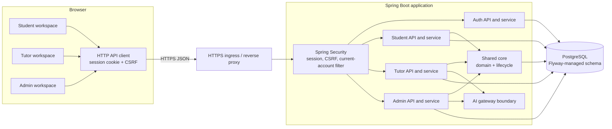
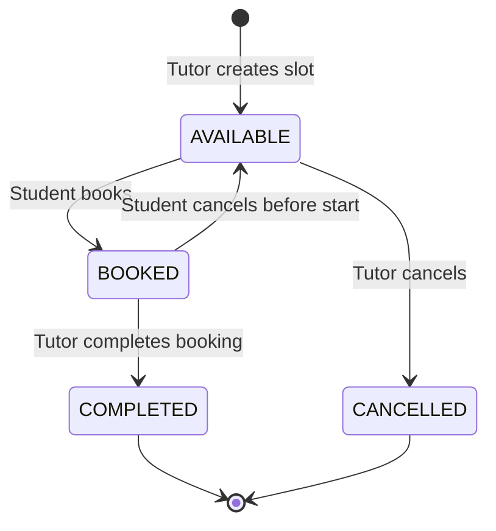
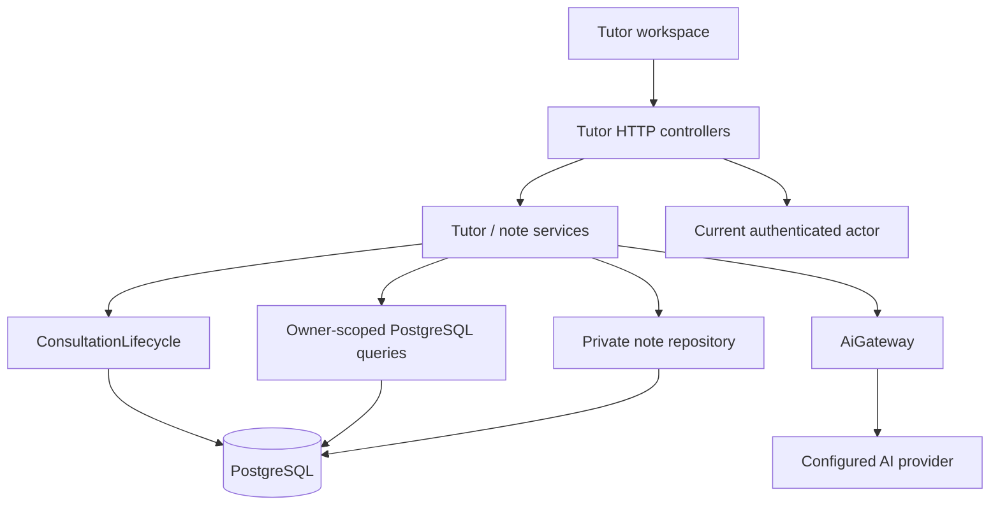

# Developer Guide

## 1. Introduction

UniChope MP3 is a browser-based consultation booking system. The web application
uses role-specific Student, Tutor, and Admin experiences, a Java backend, and
PostgreSQL persistence. The backend is the authority for identity, permissions,
validation, and consultation state; the browser does not connect to the database.

This guide describes the current backend implementation and the intended web
architecture recorded in the team specifications. Where a feature or deployment
component is not implemented in this checkout, that status is stated explicitly.
The product and API contracts are in `workflow/`; local backend setup is in
`src/backend/README.md`.

## 2. Technology and repository structure

| Area | Technology or location |
| --- | --- |
| Browser client | React, TypeScript, Vite, and Bootstrap are the shared technical specification's web-client choices. `src/frontend/` currently contains its README rather than the application source. |
| Backend | Java 25, Spring Boot 4.0.8, Spring MVC, Spring Security, and Gradle wrapper 9.1.0 |
| Database | PostgreSQL with Spring JDBC `JdbcClient` and Flyway runtime migrations |
| Password hashing | Argon2id through BouncyCastle |
| Backend tests | JUnit and Spring Boot Test; PostgreSQL-specific tests run separately against an explicitly configured disposable database |
| Contracts and design | `workflow/` product, technical, and integration specifications |
| User documentation | `docs/UserGuide.md` and this guide |

Backend sources are organized by role and shared platform responsibilities:

```text
src/backend/src/main/java/unichope/
  admin/                 Admin API, service, reports, and PostgreSQL queries
  student/               Student booking and read APIs
  tutor/                 Tutor API, service, and private consultation notes
  platform/
    auth/                Login, password hashing, sessions, and actor identity
    core/                Shared domain, repository contracts, PostgreSQL adapters,
                         and atomic consultation lifecycle
    ai/                  AI gateway and provider boundary
    runtime/             Spring wiring, profiles, bootstrap, and report gateway
    web/                 Security configuration, request filters, and safe errors
src/backend/src/main/resources/db/migration/
                         Runtime Flyway migrations V1–V7
workflow/                Product, role, technical, and integration contracts
docs/                    User and developer guides
```

Role packages depend on shared `platform` contracts. Shared platform code does not
depend on role packages. HTTP controllers handle request/response mapping and
validation; services apply role rules; repository adapters perform parameterized
SQL. The shared consultation lifecycle is the only route for slot and booking
state transitions.

## 3. Whole-web architecture

The browser presents each role's workspace and sends JSON requests to the same
application backend. The server obtains the actor from the authenticated session,
checks current account state and role, and then delegates to the role service. The
service uses shared core contracts and PostgreSQL-backed repositories. It never
accepts a browser-supplied actor ID as proof of identity.



The ingress represents the HTTPS boundary expected in a deployment; it is not a
separate microservice. The runtime uses a single Spring Boot application and one
PostgreSQL database per environment. In this checkout, backend APIs and database
wiring exist; the React source is not present under `src/frontend/`. The diagram
shows the end-to-end product boundary specified for the team, not a claim that the
frontend or a particular hosting platform is included here. Tutor/Admin AI calls
pass through the shared gateway boundary; production AI availability is described
in [AI integration](#9-ai-integration-boundary).

### Main components

| Component | Responsibility |
| --- | --- |
| Browser role workspaces | Render role-specific pages, filters, forms, and confirmations; keep private unsaved note/draft state in the Tutor workspace. |
| Auth and security | Authenticate credentials, rotate sessions, enforce CSRF, refresh account/role state, and deny protected requests when an account is inactive or a Tutor must change an initial password. |
| Role controllers | Validate HTTP input and map service results/failures to JSON responses. Controllers do not contain SQL or own business policy. |
| Role services | Apply role-specific eligibility, ownership, and business rules; call shared lifecycle and repositories. |
| `platform/core` | Shared domain records, account storage, repository contracts/adapters, and locked/atomic slot-booking transitions. |
| PostgreSQL | Persist accounts, modules, assignments, slots, bookings, notes, and AI admission data represented by runtime migrations. |
| AI gateway | Boundary between role-specific validated requests and configured providers/admission controls. Fake mode is local-only. |

## 4. Application startup and request flow

### Startup and configuration

Default startup remains closed. The integrated API runs with the `app-api` Spring
profile and explicit PostgreSQL settings. For local development, the backend guide
uses `./gradlew bootRun --args='--spring.profiles.active=app-api,local'`; production
uses HTTPS and omits the `local` cookie profile. Set the JDBC URL, username, and
password through `UNICHOPE_JDBC_URL`, `UNICHOPE_JDBC_USER`, and
`UNICHOPE_JDBC_PASSWORD`. Runtime Flyway migrations V1–V7 are applied from
`db/migration`.

Production session cookies use `Secure`, `HttpOnly`, and `SameSite=Lax` attributes
with a 30-minute idle timeout. The `local` profile permits HTTP cookies for
localhost development. The HTTPS proxy must preserve the secure request scheme;
only trusted proxy forwarding headers should be enabled.

The initial Admin is provisioned explicitly with `./gradlew bootstrapAdmin` and
one-time `UNICHOPE_ADMIN_*` values. The command uses a database lock and persisted
marker; it does not expose a public bootstrap endpoint or default password. Remove
the bootstrap credentials after setup. The current session implementation is in
memory and supports one application replica; a process restart signs users out
while PostgreSQL records remain.

### Login and Tutor first sign-in

```mermaid
sequenceDiagram
    actor User
    participant Web as Browser client
    participant Auth as Auth API / service
    participant Store as Account storage
    User->>Web: Enter email and password
    Web->>Auth: POST /api/auth/login (CSRF)
    Auth->>Store: Read credential snapshot
    Auth->>Auth: Verify password outside database locks
    Auth->>Store: Confirm observed hash, role, and session generation
    Auth-->>Web: Authenticated identity + rotated session cookie
    Web->>Auth: GET /api/auth/me
    Auth-->>Web: Current role and mustChangePassword flag
    alt Tutor must change initial password
        Web->>Auth: POST /api/auth/change-password (CSRF)
        Auth->>Store: Update hash, clear flag, increment generation
        Auth-->>Web: Success; current session is revoked
        Web->>Auth: Sign in again with the new password
    else Password change not required
        Web-->>User: Show the role workspace
    end
```

`SessionPrincipal` contains only the user ID and session generation. On protected
requests, `CurrentAccountFilter` reloads the stored account state and derives role
authorities; services also recheck eligibility inside their mutation boundary.
Login rotates the session ID. Unsafe requests require CSRF. New Tutor accounts and
existing Tutors flagged by the one-time V7 runtime migration must change their
initial password before using Tutor APIs. The password and confirmation must match
and contain 8–128 Unicode code points. A successful change increments the session
generation, so the Tutor signs in again with the new password. Student and Admin
accounts are unaffected.

### Consultation lifecycle

The lifecycle groups each booking transition with its slot transition in one
transaction. Parent rows are locked in the shared order (users sorted by PostgreSQL
UUID, then modules, slots, bookings, and feature rows); eligibility and ownership
are rechecked after locks. The code uses READ COMMITTED transactions with bounded
lock and statement waits and does not retry mutations automatically.



Booking changes the booking to `ACTIVE` and the slot to `BOOKED` atomically.
Student cancellation changes the booking to `CANCELLED` and releases the slot to
`AVAILABLE`. Tutor completion changes an `ACTIVE` booking and its `BOOKED` slot to
`COMPLETED` together. A partial unique index prevents more than one active booking
per slot. Slot intervals are half-open (`[start, end)`), allowing adjacent slots.

## 5. Tutor component design

Tutor APIs are composed into the `app-api` profile and use the authenticated
session's trusted actor identity. Tutor code uses `platform/core`, `platform/auth`,
`platform/ai`, and `platform/web`; it does not depend on Student or Admin packages.
Private-note storage remains in `tutor/`, while shared slot and booking persistence
and transitions remain in `platform/core`.



The Tutor workspace covers slot management, bookings, and completed consultation
history and notes. Backend responsibilities are:

- **Slots:** list upcoming slots, expose active assigned modules, validate future
  intervals and module assignment, and prevent overlap with the Tutor's AVAILABLE
  or BOOKED slots. Only an owned AVAILABLE slot can be cancelled.
- **Bookings:** filter by module, Singapore date, and status; constrain every query
  to the authenticated Tutor's owned slots. Completion requires an `ACTIVE` booking
  paired with a `BOOKED` slot and commits both state changes together. The current
  rule permits recording completion before the scheduled start.
- **History and notes:** show slot history and completed bookings. Note reads and
  writes require an owned completed booking. A missing note has version 0; save
  creates version 1 or replaces a note only when its expected version matches.
  Stale writes return a conflict and do not overwrite the newer note.
- **AI draft:** accepts rough notes only after checking active Tutor ownership and
  completed status. The generated draft is returned for review and is never saved
  automatically. A separate explicit save uses the note version check.

Tutor queries use deterministic ordering and SGT date boundaries converted to UTC
instants. Wrong-owner and missing resource IDs share the same not-found behavior.
The browser treats generated text as plain text, binds async responses to the
current account/booking/sequence, and clears private buffers on sign-out or account
change. These browser behaviors are specified in `workflow/tutor/TECHNICAL-SPEC.md`;
frontend source is not present in this checkout.

## 6. Student

Student booking is wired into `app-api` with an actor adapter backed by the same
session principal. The service reads bookable slots and creates or cancels bookings
through `ConsultationLifecycle`, so Student code cannot write slot/booking state
directly. A booking requires an active Student and a future available slot; an
overlap with that Student's active booking is rejected. Cancellation is allowed
only for the Student's own active booking before the slot starts. Student endpoint
and response contracts are owned by `workflow/student/TECHNICAL-SPEC.md` and
`workflow/INTEGRATION-SPEC.md`.

## 7. Admin

Admin controllers parse strict bounded JSON and delegate business rules to
`AdminService`. Account operations use shared core storage rather than duplicate
SQL. Module and assignment writes coordinate on the same parent locks as the
consultation lifecycle, in PostgreSQL UUID order. Admin does not change consultation
status directly. Statistics use one SQL statement for a consistent aggregate
snapshot. Report prompts receive aggregate totals and rates only; account identity
and private notes are excluded.

## 8. Persistence and consistency

PostgreSQL is the persistent store for business records. Flyway runtime migrations
V1–V7 cover the core schema, account credentials, private notes, initial Admin
marker, AI admission schema, and Tutor first-login password change. The separate
`db/core-review` and `db/auth-review` SQL locations are isolated review/test schemas;
they are not activated by the runtime profile. Runtime migrations are not a
backfill path for credentialless accounts from those review schemas. Use a new,
empty database for first setup unless an explicit migration plan has been approved.

| Data | Owner / purpose |
| --- | --- |
| Users and credentials | Shared core/auth; public user and response objects do not expose password hashes |
| Modules and Tutor assignments | Shared core; active assignments control Tutor slot creation/options |
| Slots and bookings | Shared core; related state changes go through `ConsultationLifecycle` |
| Private notes | Tutor; keyed to completed bookings and versioned to prevent stale overwrites |
| AI admission state | Shared AI infrastructure migrations; quotas and provider availability remain subject to the integration boundary below |
| Bootstrap marker | Runtime database marker prevents repeated initial Admin provisioning |

Repository writes use parameterized SQL and map rows to domain values. Cross-record
rules are enforced by services and the locked lifecycle transaction, with database
constraints for key uniqueness invariants. Each lifecycle mutation owns its
transaction and rollback; a surrounding caller transaction does not extend across
that boundary. Do not bypass the lifecycle with direct repository writes for slot
or booking changes. Do not automatically retry after lock timeout or deadlock;
return the sanitized temporary-unavailability response and let the caller decide.

## 9. Security, time, and diagnostics

Passwords are hashed with Argon2id (19 MiB, two iterations, one lane) before
storage. Hash material is kept behind the credential storage boundary and is not
returned in DTOs. API errors are mapped to safe JSON; SQL causes, credentials, and
note contents must not be exposed in responses or logs. Login throttling and session
state are in-memory and single-replica in the current implementation.

Slot and booking timestamps are instants. Date filters are interpreted in
`Asia/Singapore` and converted to UTC for database queries. Core truncates slot
timestamps to PostgreSQL microsecond precision before validation. Injected clocks
are used by backend services where time-dependent rules apply, so tests can control
the current time.

Admin statistics are aggregate-only for AI input. Tutor rough notes are user data
and are sent only through the configured AI gateway after authorization. Generated
content is untrusted: Tutor output is structurally validated and must be reviewed
before a manual save. Never put provider secrets or raw private note content in
diagnostic logs.

## 10. AI integration boundary

The gateway is shared, while each role selects authorized context and validates
task-specific output. Fake mode is explicitly local; production defaults to
`AI_UNAVAILABLE`. The Student-owned real SoC provider adapter and durable shared
quotas/budgets are not implemented by this increment. Do not connect an unrestricted
provider to bypass those controls. Real-model quality and provider resource limits
remain release dependencies. Manual Tutor notes remain usable while AI is
unavailable. Admin reports can render without a provider when no report content is
needed; nonempty production reports currently return `AI_UNAVAILABLE`.

## 11. Specifications and verification

The role specifications and integration contracts are the source for detailed
requirements and HTTP shapes:

- `workflow/SHARED-TECHNICAL-SPEC.md` and `workflow/INTEGRATION-SPEC.md` define
  shared layering, APIs, authentication, and consultation locking.
- `workflow/auth/` documents session, credential, and first-login password rules.
- `workflow/tutor/` documents Tutor APIs, notes, AI drafts, and frontend state.
- `workflow/student/` documents Student booking and its runtime integration.
- `workflow/admin/` documents management and aggregate reporting.

Implementation changes are checked against requirement/case IDs, tests, and
independent review. First-person interaction summaries under `logs/` require human
verification; internal work notes are not product documentation. The recorded
backend checks cover authentication/HTTP integration, management guards, snapshot
statistics, and concurrent parent-lock behavior.

From `src/backend/`, run unit/integration tests and build the application with:

```sh
./gradlew test bootJar
```

PostgreSQL-tagged tests require an explicitly configured disposable PostgreSQL 17
database with permission to create schemas:

```sh
./gradlew test postgresTest bootJar \
  -Dcore.test.jdbcUrl="$CORE_TEST_JDBC_URL" \
  -Dcore.test.user="$CORE_TEST_USER" \
  -Dcore.test.password="$CORE_TEST_PASSWORD"
```

These tests create and drop unique schemas. Never point them at production or a
shared development database. `postgresTest` covers database-specific behavior such
as lifecycle transactions and concurrency; unit tests alone do not establish
PostgreSQL locking behavior. Record the actual command and result when reporting
verification; a documented command is not evidence that it was run.

## 12. Known limits and acknowledgements

- The frontend source is not present under `src/frontend/`, and this checkout
  does not include deployment manifests or hosting configuration. The React
  architecture is specified by the shared technical document.
- Server-side sessions and login counters are in memory and require a single app
  replica. Restarting the app invalidates sessions and clears login limits.
- There is no password reset flow. Initial Tutor password change is mandatory;
  account recovery/provisioning remains an Admin or deployment operation.
- Real SoC integration and durable shared AI quotas are not available in this
  increment; fake AI mode is for local development only.
- Runtime V1–V7 migrations do not backfill legacy credentialless review databases.
  Plan and review any existing-data migration before deployment.

Admin/auth behavior adapts selected UniChope MP2 designs and code candidates; this
project does not import the MP2 source files or database. Shared core and Tutor
interfaces are implemented against the MP3 team contracts. See [the reuse
inventory](REUSE.md) for attribution. Framework and runtime dependencies are
Spring Boot/Security/JDBC, PostgreSQL/Flyway, Jackson, and BouncyCastle.

## Appendix A. Functional requirements

This table summarizes the product-level requirements. It is a navigation aid,
not a replacement for their acceptance criteria. The shared product specification
is a team-review draft; check the linked role specifications for detail and
implementation evidence before treating a proposed feature as released.

| ID | Summary | Detailed source |
| --- | --- | --- |
| AUTH-01, AUTH-02 | Sign in/out, route by stored role, and deny protected access to unauthenticated or inactive accounts. | [Shared Product Spec](../workflow/PRODUCT-SPEC.md), [Auth Technical Spec](../workflow/auth/TECHNICAL-SPEC.md) |
| STU-01 | Browse future available consultations, book a slot, and view or cancel eligible own bookings. | [Student Product Spec](../workflow/student/PRODUCT-SPEC.md) |
| STU-AI-01 | Prepare an editable consultation agenda from the student's questions and authorized context. | [Student Product Spec](../workflow/student/PRODUCT-SPEC.md) |
| TUT-01 | Manage own slots and bookings, complete consultations, and maintain private notes with optional AI drafts. | [Tutor Product Spec](../workflow/tutor/PRODUCT-SPEC.md) |
| ADM-01 | Manage accounts, modules, and tutor assignments; inspect booking activity and statistics. | [Admin Product Spec](../workflow/admin/PRODUCT-SPEC.md) |
| ADM-AI-01 | Request a reviewed explanation of aggregate booking statistics without using private consultation notes. | [Admin Product Spec](../workflow/admin/PRODUCT-SPEC.md) |

## Appendix B. Non-functional requirements

The shared product spec defines these cross-cutting acceptance conditions. Some
items, especially online deployment and live SoC service limits, remain release
dependencies rather than claims made by this guide.

| ID | Requirement summary |
| --- | --- |
| SEC-01 | Check role, active-account status, and record ownership on protected reads, writes, and AI calls. |
| SEC-02 | Send only the minimum authorized context to AI; exclude credentials and unrelated records; treat generated content as untrusted. |
| SEC-03 | Keep AI advisory: it cannot perform bookings, cancellations, completion, account changes, or note saves. |
| REL-01 | Persist successful changes across application restarts and keep related records consistent when an operation is rejected. |
| AI-01, AI-02 | Keep SoC credentials server-side, enforce per-user and shared budgets, and preserve ordinary workflows when AI fails. |
| DEP-01, DEP-02 | Release access over HTTPS, separate development and production resources/secrets, and keep automated tests off production resources. |
| UX-01 | Give each role loading, empty, validation, success, and failure states in its workspace. |

## Appendix C. User stories

Stories describe user goals; the role specifications define their acceptance
criteria. The summaries below do not add behavior beyond those specifications.

| Role | User goal summary | Detailed stories |
| --- | --- | --- |
| Student | Find and manage consultations, and prepare an editable agenda from personal questions. | [US-S01–US-S06](../workflow/student/PRODUCT-SPEC.md#3-functional-requirements-and-acceptance-criteria) |
| Tutor | Manage availability, find and complete bookings, review history, and keep private notes with optional AI drafting. | [US-T01–US-T09](../workflow/tutor/PRODUCT-SPEC.md#3-functional-requirements-and-acceptance-criteria) |
| Admin | Manage accounts, modules, and tutor assignments; review activity and statistics. The Admin spec records these as role requirements rather than a numbered user-story list. | [Admin role requirements](../workflow/admin/PRODUCT-SPEC.md#role-requirements) |

## Appendix D. Glossary

| Term | Meaning in this guide |
| --- | --- |
| Active account | An account currently allowed to use its role's protected features. The server checks current stored status, including for an existing session. |
| AI gateway | Shared server-side boundary that admits a role's authorized AI request and delegates it to a configured provider. |
| CSRF | Cross-Site Request Forgery protection. The browser sends the session's CSRF token on state-changing requests. |
| Consultation lifecycle | Shared core operations that validate and atomically transition consultation slots and bookings. |
| Flyway migration | A versioned SQL change applied to the runtime database schema. |
| SGT | Singapore Time (`Asia/Singapore`), used for displayed times and date filters. |
| Session generation | A stored account counter compared with the value in a session; changing it invalidates older sessions. |
| SoC LLM | The team's School of Computing language-model service, called by trusted server-side code when configured. |
| Tutor private note | Tutor-owned note attached to a completed booking; it is not visible to students or other roles under the current product contract. |
