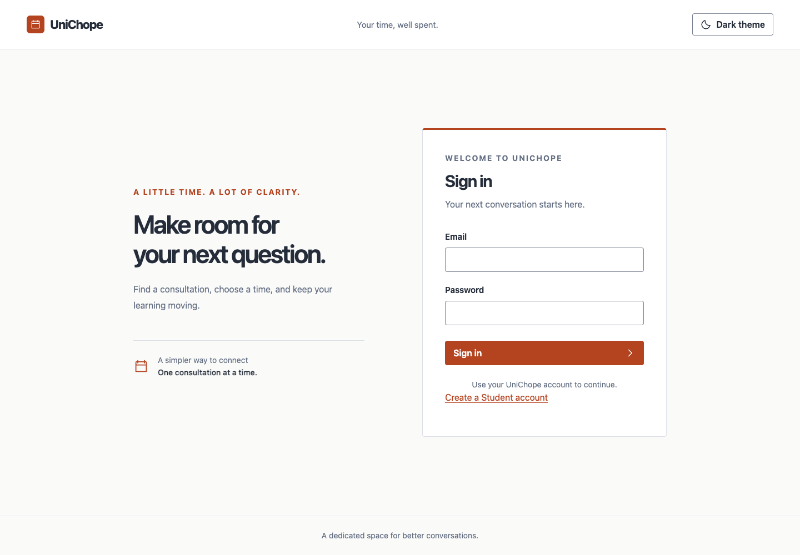
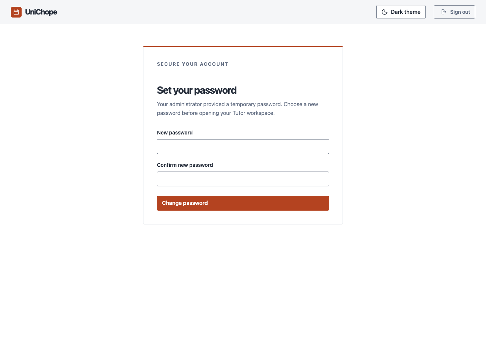
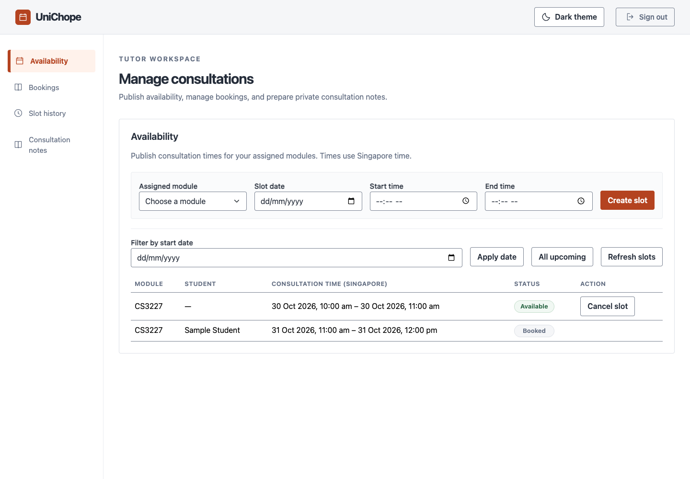
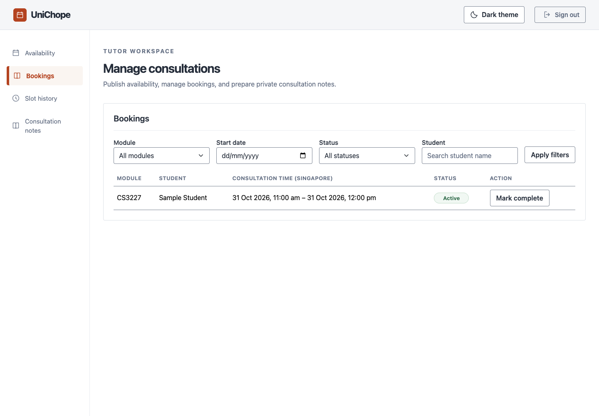
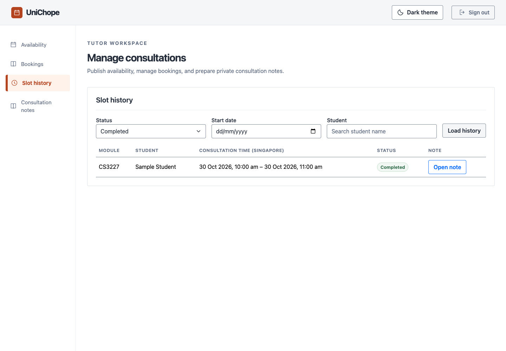
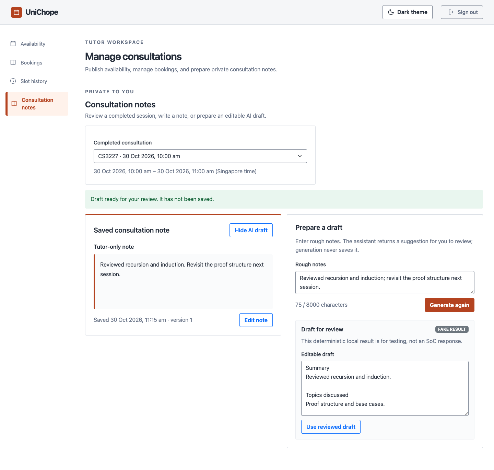

# User guide

This guide covers Student, Tutor, and Admin tasks, along with shared sign-in and
account information. Open UniChope using the website address provided by your team.

## Sign in and sign out

1. Enter your account email and password on the **Sign in** page.
2. Select **Sign in**. Your account role determines which workspace opens.
3. Select **Sign out** in the page header when you have finished.

If you received an account from an administrator, use the initial password they
provided. Passwords are case-sensitive. If sign-in fails, check your details and
try again. After too many failed attempts, wait for the time shown before retrying.

A session expires after 30 minutes without activity. If the application asks you
to sign in again, do so before continuing. An inactive account cannot sign in;
contact your administrator if you need access restored.

Self-service password reset is not available. On first sign-in, Tutors must change
the initial password (8–128 characters) and then sign in again. This requirement
also applies once to existing Tutor accounts when the update is deployed; Student
and Admin accounts are unaffected. Student and Admin accounts are not subject to
this Tutor-only first-login requirement.

After entering an initial Tutor password, complete the required password change
before opening the Tutor workspace:

## Create a Student account

1. On the sign-in page, select **Create a Student account**.
2. Enter your name and email address.
3. Enter a password of 8–128 characters and enter it again in **Confirm password**.
   Spaces count as part of the password, and both entries must match exactly.
4. Select **Create account**.
5. After successful registration, sign in with your new email and password.

Registration creates a Student account. Tutor accounts are created by an Admin.
If an account cannot be created with your email, try signing in or use another
email address. If the outcome could not be confirmed, try signing in before
submitting the registration again.

## 2. Tutor

### Workspace tour

| Tab | What you can do |
| --- | --- |
| Availability | Review upcoming slots, create slots for assigned modules, and cancel available slots |
| Bookings | Review consultations, filter the list, and complete a consultation |
| Slot history | Review past slots and open completed consultations |
| Consultation notes | Load and save private notes and request an AI note draft |

The screenshots below show the Tutor interface with synthetic sample data.

Times are shown in SGT. On **Availability**, use **Refresh slots** after
another user may have changed a slot. Follow the workspace message after each
action.

### First consultation walkthrough

1. An Admin assigns your Tutor account to an active module.
2. Sign in, open **Availability**, select the module, choose a future date and
   time, then select **Create slot**. The slot appears as `AVAILABLE`.
3. Once the slot is booked, it appears in **Bookings** as `ACTIVE` and the
   slot becomes `BOOKED`.
4. After the consultation, select the booking and choose **Mark complete**.
   The booking and slot become `COMPLETED` together.
5. Open **Consultation notes**, select the completed consultation, choose
   **Edit note** to write or revise a note, then select **Save note**. To use
   an AI draft, review it, choose **Use reviewed draft**, and save the note.

Choose a future date and time when creating a slot. The server checks for
conflicts when saving; if another slot overlaps yours, revise the time and
submit again.

### Availability

#### View upcoming availability

The **Availability** table shows your upcoming `AVAILABLE` and `BOOKED` slots.
Use the SGT date filter to see a particular day, select **All upcoming** to
clear the date filter, or select **Refresh slots** to reload the latest
information.

#### Create a slot

Choose an active assigned module, a future date, and a start and end time.
The end must be later than the start. UniChope rejects a slot that overlaps
one of your existing `AVAILABLE` or `BOOKED` slots. Adjacent slots are
allowed.

**Example:** Select `CS3227`, choose **30/10/2026**, enter `10:00` and
`10:30`, and select **Create slot**. The new row appears as `AVAILABLE`.

#### Cancel an available slot

Select an `AVAILABLE` slot, choose **Cancel slot**, and confirm. A
`BOOKED` slot cannot be cancelled by the Tutor; its Student must cancel the
booking first. Cancelled slots remain in history.

*Example screen. The displayed records are synthetic.*

### Bookings

The **Bookings** tab shows consultations for your slots, including the
Student, module, SGT date and time, and status. Filter by module, start date,
status, or student name, then select **Apply filters**. Empty results mean
there are no matching bookings; change or clear the filters to see other
records.

To complete a consultation, select its `ACTIVE` booking and choose **Mark
complete** after the consultation. Confirm the action. The booking and slot
become `COMPLETED` together. Completion can be recorded when a consultation
finishes early; only complete it after the consultation has actually ended.

*Example screen. The displayed records are synthetic.*

### Slot history

#### Review slot history

Slot history shows `CANCELLED` or `COMPLETED` slots, one status at a time.
Choose a status and optional SGT date or student name, then select **Load
history**. Leave the date blank to see all matching history for the selected
status. The separate completed-consultation list used for notes is not changed
by the slot-history filter.

*Example screen. The displayed records are synthetic.*

### Consultation notes

#### Load and save a note

Select a completed consultation from the list. Its saved note loads
automatically. Choose **Edit note** to enter or revise the note, then choose
**Save note**. The note belongs to that consultation and remains available
after signing out and back in. If another session has saved a newer version,
reload the saved note before saving to avoid overwriting that newer note.

#### Generate and review an AI note draft

Enter rough notes for the selected completed consultation and choose
**Prepare AI draft**, then select **Generate draft**. The assistant suggests a
structured draft with **Summary**,
**Topics discussed**, and **Follow-up** sections. Review the content and edit
it as needed. Choose **Use reviewed draft** to place the reviewed text in the
note editor, then choose **Save note** to save it.

For clearer drafts, write short, factual points about one consultation. Include
the topic, what was discussed, and any agreed follow-up. Separate confirmed
details from questions or plans, and leave out information that is not needed.
For example:

> Topic: Recursion base cases. Discussed tracing a recursive function with a
> small input. Follow-up: Student will attempt two practice questions before
> the next session.

AI text is only a suggestion, not a verified record. It may omit facts or add
unsupported details, so compare every statement with what happened and remove
anything you cannot verify. Generation alone does not save a note or change a
booking. Do not include unnecessary personal or sensitive information in rough
notes. If generation fails, times out, or returns no usable draft, your rough
notes remain available; write the note manually or try again later. A **FAKE
RESULT** badge means the app returned deterministic local test output, not a
SoC response.

*Example screen. The displayed records are synthetic; the AI draft shown is a local test result.*

## Find your way around the Admin workspace

After signing in as an Admin, use the navigation to open:

| Page | Use |
| --- | --- |
| **Overview** | View booking totals, percentages and breakdowns. |
| **Users** | Create Student/Tutor accounts and manage their access. |
| **Modules** | Create, edit and deactivate teaching modules. |
| **Tutor assignments** | Assign tutors to modules or remove assignments. |
| **Booking activity** | View and filter consultation booking records. |
| **Activity report assistant** | |

Select **Refresh** to reload the records on a page. On smaller screens, scroll
horizontally through the navigation to reach the other pages. Use the theme button
in the header to switch between light and dark appearance.

## Manage users

### Create an account

1. Open **Users**.
2. Under **Create account**, choose **Student** or **Tutor**.
3. Enter the person's full name and email address.
4. Enter an initial password of 8–128 characters.
5. Select **Create account** and wait for **Change saved**.
6. Share the account email and initial password securely with the account owner.

The password field clears after submission. Existing passwords are not displayed.
You cannot create Admin accounts or change account roles from this page.

### Find an account

Under **Accounts**, use **Filter role** and **Filter account status** to narrow the
list. Each row shows the person's name, email, role and current access status.

### Deactivate or reactivate an account

1. Find the Student or Tutor in **Accounts**.
2. Select **Deactivate** or **Reactivate**.
3. Read the confirmation message. Select **Go back** to leave the account unchanged,
   or **Confirm change** to proceed.
4. Wait for confirmation and check the updated status.

Deactivation prevents access and retains the account's history. Reactivation
restores access; previously revoked sessions require a new sign-in. Admin accounts
are marked **Protected account** and cannot be changed here.

A Student cannot be deactivated while they have an active booking. A Tutor cannot
be deactivated while affected active bookings or future available slots remain.
Resolve those commitments through the relevant Student or Tutor workflow, then
refresh the account list before trying again.

## Manage modules

### Create a module

1. Open **Modules**.
2. Under **Create module**, enter a module code and module name.
3. Use 1–20 letters, digits or hyphens for the code, and up to 200 characters for
   the name. Module codes must be unique.
4. Select **Create module** and wait for confirmation.

### Edit a module

1. Select **Edit** beside the module.
2. Change its code or name in the form.
3. Select **Save module**, or **Cancel editing** to discard the form changes.

Editing keeps the module's existing bookings and history associated with it.

### Deactivate a module

1. Select **Deactivate** beside an active module.
2. Read the message and select **Confirm change**, or **Go back** to cancel.
3. Check that the module is marked **Inactive**.

Active bookings and future available slots can prevent deactivation. Resolve those
commitments before trying again. Deactivation retains history; module deletion and
reactivation are not offered in this interface.

## Manage tutor assignments

### Assign a tutor to a module

1. Open **Tutor assignments**.
2. Under **Assign a tutor**, choose an active Tutor and an active module.
3. Select **Assign tutor** and wait for confirmation.
4. Check the pair under **Current assignments**.

Only active Tutors and active modules appear as choices. Assigning a pair that
already exists does not create a duplicate.

### Remove an assignment

1. Find the pair under **Current assignments**.
2. Select **Remove**.
3. Read the message and select **Confirm change**, or **Go back** to cancel.

Removal is blocked while that Tutor/module pair has active bookings or future
available slots. Other assignments are unaffected, and booking history is retained.

## View booking activity

1. Open **Booking activity**.
2. Narrow the records using **Module**, **Tutor**, **Status** or
   **Consultation date (SGT)**. Filters apply together.
3. Select **Reset filters** to show all records again, or **Refresh** to reload.

The table shows the module, Student, Tutor, consultation time and booking status.
Dates and times use Singapore time (SGT). The date filter refers to the consultation's
start date. Statuses are **ACTIVE**, **COMPLETED** and **CANCELLED**.

Bookings are read-only on this page. Admins do not cancel or complete bookings here,
and private consultation notes are not displayed.

## Read the overview statistics

Open **Overview** to see:

- Total booking records.
- Completed and cancelled booking counts.
- Completion and cancellation percentages.
- Booking counts by module and Tutor.

Statistics cover all booking history, including inactive accounts/modules and
cancelled bookings. A cancelled booking followed by a new booking counts as two
records. Both percentages use all booking records as their denominator. For example,
two completed records out of four total records gives a 50% completion rate.
When there are no bookings, counts and percentages are zero.

Check the snapshot capture time to see when the figures were read. Select
**Refresh** for a new snapshot.

## Activity report assistant

## If something goes wrong

| Message or situation | What to do |
| --- | --- |
| Session expired or sign-in requested | Sign in again before continuing. |
| Account inactive | Contact your administrator about restoring access. |
| Access denied | Check that you are using the correct account and workspace. |
| Details already exist | Check the account email or module code; refresh the list before creating again. |
| Change blocked by bookings or slots | Resolve the relevant active bookings or future available slots, then refresh and retry. |
| Security token expired | Submit again as prompted; the application obtains a fresh token. |
| Request limit reached | Wait before trying again. |
| Service unavailable | Try **Refresh** or try again later. |
| Outcome could not be confirmed | Refresh and inspect the records before resubmitting. The first change may already have completed. |

Wait for each submitted change to finish. Leaving the page does not guarantee that
an operation already sent has been cancelled.

## Frequently asked questions

### Account and sign-in

#### What timezone does UniChope use?

Dates and times throughout the app are shown in Singapore time (SGT).

#### Do I need an account, and how do I get one?

Students can register for a Student account from the sign-in page. Admins create
Student and Tutor accounts; ask your organization's UniChope administrator for
access if you are a Tutor or Admin. Your role is assigned to your account and
cannot be selected at sign-in.

#### Why was I signed out?

Sessions expire after 30 minutes of inactivity. Sign in again. If an Admin
deactivated and then reactivated your account, you must also sign in again before
using the app.

#### Can I reset a forgotten password myself?

No. UniChope has no self-service password reset. Contact an Admin through your
usual support channel.

### Student FAQs

#### How do I find and book a consultation?

Browse future available slots, filter by module or date, and select a slot to
book. A booking is confirmed only if the slot is still available and does not
overlap another active booking of yours. Refresh the list if a slot is no longer
available.

#### Can I cancel a booking?

You can cancel your own upcoming active booking before its start time. Cancelling
releases the slot for another Student. Past or already completed bookings cannot
be cancelled.

#### Can a Student see Tutor consultation notes?

No. Tutor consultation notes are private to the Tutor and are not shown to
Students.

#### Does the AI agenda answer my questions or book a consultation for me?

When available, the agenda is a preparation suggestion based on your questions.
Review it yourself; AI does not book, cancel, or change consultations. If AI is
unavailable, you can still use the normal booking features.

### Tutor FAQs

#### Can I create my own Tutor account?

No. Ask an Admin for a Tutor account and an active module assignment.

#### What happens when I sign in with my initial password?

UniChope asks you to set and confirm a password between 8 and 128 characters.
The Tutor workspace stays unavailable until the change succeeds. Your current
session is then revoked; sign in again with the new password.

#### Why can’t I cancel a booked slot?

The Student must cancel the booking first. Once the slot is available again,
you can cancel it from **Availability**. See the [availability screen](images/tutor-availability.png).

#### What happens when I mark a booking complete?

After the consultation has ended, choose **Mark complete**. The booking and
its slot are marked `COMPLETED` together. See the [bookings screen](images/tutor-bookings.png).

#### Does generating an AI draft save my note?

No. Review the draft, choose **Use reviewed draft**, then choose **Save note**.
See the [consultation notes screen](images/tutor-consultation-notes.png).

#### Who can see my consultation notes?

Notes are private to you and belong to the completed consultation. Reload the
saved note before saving if another session may have changed it.

### Admin FAQs

#### What can an Admin manage?

Admins can manage Student and Tutor accounts, modules, and Tutor-module
assignments, and review booking activity and statistics. Admin actions may be
rejected when active bookings or future available slots would be affected.

#### Can an Admin read Tutor consultation notes?

No. Admin booking activity and statistics exclude private Tutor notes.

#### Does an AI activity report change bookings or accounts?

No. It returns a draft explanation of aggregate statistics for review. It cannot
change bookings, accounts, modules, or assignments. Real AI reports may be
unavailable while the shared service is being configured; ordinary Admin
management and statistics remain available.
