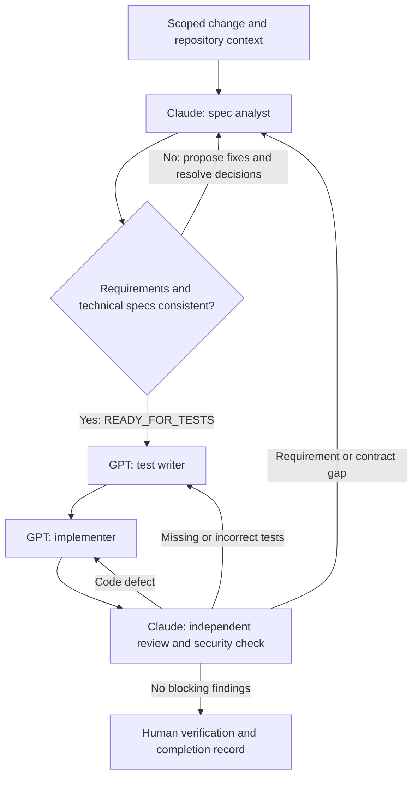

# Student development note: spec driven agent workflow

Status: workflow ready to use; no feature specification, implementation, test run,
or Claude review is claimed by this document.

## Purpose and scope

Use Claude to specify and independently review changes. Use GPT to write tests
and implement the agreed behavior. Keep each agent focused on one responsibility
with an explicit handoff, rather than asking one conversation to do everything.

**Student is the location of this workflow, not its feature boundary.** Apply it
to Student features and relevant shared work: login/logout, session handling,
shared navigation and UI, backend integration, and local AI integration. It can
also be reused by Tutor and Admin owners. Location does not transfer ownership
of shared code or authorize changing another teammate's contracts.


## Agents and model assignment

| Agent | Run with | Responsibility | Produces |
| --- | --- | --- | --- |
| [Spec analyst](agents/spec-analyst.md) | Claude | Audit requirements against technical/integration specs, propose and resolve fixes, specify behavior and plan tasks | Coverage matrix, findings/resolutions, spec readiness verdict, acceptance IDs and plan |
| [Test writer](agents/test-writer.md) | GPT | Turn acceptance criteria into independent behavioral tests before implementation | Tests, acceptance-to-test mapping, expected failure evidence |
| [Implementer](agents/implementer.md) | GPT | Implement one agreed task while preserving contracts and test intent | Code, passing verification evidence, limitations |
| [Reviewer / security checker](agents/reviewer-security.md) | Claude, fresh session | Inspect spec, tests and diff independently; examine security and integration | Findings with evidence, review verdict, retest requirements |

These are reusable role prompts, not automatically registered agents. Open the
chosen Claude or GPT tool, paste the role prompt and the handoff below, and attach
or provide access to the referenced files. Use separate sessions for test writing,
implementation, and review. A launcher may delegate only if it supports selecting
the required model; otherwise hand off manually. Never label a GPT review as a
Claude review. If the required model is unavailable, record that stage as pending.

## Read the existing contracts first

- [Product baseline](../PRODUCT-SPEC.md): scope, role boundaries, assignment constraints.
- [Shared technical spec](../SHARED-TECHNICAL-SPEC.md): architecture, security, AI and tests.
- [Integration spec](../INTEGRATION-SPEC.md): APIs, DTOs, lifecycle and locking contracts.
- [Authentication specs and plan](../auth/PLAN.md): existing login/session responsibilities.
- Relevant [Tutor](../tutor/PLAN.md) and [Admin](../admin/PLAN.md) contracts when affected.
- Applicable repository instructions and skills, actual source and build configuration.

The existing specifications are drafts. Do not treat their presence as approval
or as evidence that code exists. Read the current [Student product spec](PRODUCT-SPEC.md),
[Student technical spec](TECHNICAL-SPEC.md) and [Student plan](PLAN.md) when relevant;
their presence does not replace the task-specific consistency and readiness check.

## The working loop

### 0. Check scope before choosing a path

The agent receiving a request first reads the relevant files and classifies the
work below. State the chosen path and why in the change record, or in the response
for a trivial edit. Use existing authorization; the scope check itself does not
require another approval round.

| Request | Path |
| --- | --- |
| Trivial, localized edit with clear intent and no change to behavior or contracts, such as a typo, broken documentation link or comment correction | Shorter path below |
| One independently testable capability, behavior change, or bug fix | Standard stages 1-5 below, using an existing agreed spec where applicable |
| Several independently testable capabilities | Split into separate changes, then run the standard stages for each |

Split by user-visible outcome, not by file, layer or role. For example, shared
login UI, booking cancellation and AI agenda generation are separate capabilities.
A login page and its API integration can be tasks within the same capability.
Give each split change its own goal, acceptance IDs, scope, owner and handoff
record. Record shared prerequisites and dependencies, choose a dependency-safe
order, and complete prerequisite work before a dependent task. Do not silently
drop the remaining requested capabilities when finishing the first one.

**Shorter path:** state a brief acceptance condition, make the focused edit,
inspect the diff and run a proportionate check such as link or formatting
validation. Report what changed and the actual verification result. A new spec,
plan, change record, separate agent sessions and a full review cycle are not
required for that edit. Do not add tests that merely mirror a documentation edit.

Small diffs can still change behavior or carry risk. Changes to authentication,
authorization, data integrity, API contracts, secret handling or AI trust boundaries
use the standard path. If a seemingly trivial edit reveals a behavior change,
material ambiguity or shared dependency, reclassify it before continuing. Keep
bug diagnosis and applicable repository skill requirements in effect.

The diagram below describes the standard path after the scope check.



### 1. Claude specifies one small change

The analyst also performs a technical readiness check before handoff. First audit
the request and current documents without changing them. Map each requirement to
the role/shared technical and integration contract that supports it. Record gaps,
contradictions, unverified assumptions and implementation drift with references.
Do not silently prioritize an existing draft over the request or change a shared
contract to make the conflict disappear.

For each flaw, propose a concrete fix, its target document, impact, affected tests
and decision owner. Apply already-authorized clarifications; keep material policy
or cross-owner changes proposed until the required decision is recorded. Recheck
the revised specs and record each finding's resolution. A report containing only
questions, without recommended fixes where evidence permits them, is incomplete.

Read the current behavior and authoritative contracts. Describe the goal,
non-goals, affected roles and files, owner dependencies, and externally visible
behavior. Give each acceptance criterion a stable ID and Given/When/Then scenario.
Cover success, validation, authorization, ownership, relevant races and failures.
For UI changes specify loading, empty, error, success, keyboard and session states.
For AI specify authorized context, limits, failure behavior, and what the model
cannot do. Identify assumptions separately from human decisions.

Update existing canonical documents instead of inventing a competing auth or API
spec. New Student features belong in `workflow/student/PRODUCT-SPEC.md`,
`TECHNICAL-SPEC.md`, and `PLAN.md` when needed. Shared changes also update the
shared/integration or Auth documents that actually own the contract.

Split the plan into tasks small enough to test and review independently. Each
task names acceptance IDs, prerequisites, permitted files, and verification.
Before coding, resolve material ambiguities and establish the agreed baseline.
Shared contract changes need the affected owner's agreement/review under the
existing team rules. Routine implementation details within that baseline do not
need repeated permission.

Record READY_FOR_TESTS only for a named task whose acceptance criteria and
technical contracts agree, blocking findings are resolved, necessary decisions
are recorded and validation is feasible. Use CHANGES_REQUIRED for unresolved
actionable flaws or BLOCKED for essential unavailable evidence/decisions. Deferred
provider details need not block fake-backed tasks that do not depend on them.
Spec readiness proves document consistency for that scope, not working software.

For example, if a proposed login flow stores a session secret in browser storage,
cite its conflict with SH-AUTH-02, explain the exposure, propose server-side
sessions with the configured cookie/CSRF flow, and update the agreed UI/technical
contract before tests are written. Add acceptance coverage for logout/session
expiry and private-state clearing. This is an illustrative finding, not a claim
that the current application contains this defect.

### 2. GPT writes tests against the spec

Before editing tests, verify the analyst's readiness verdict and spec revision
for this task. Read its findings and fixes; return unresolved or stale contracts
to Claude rather than inventing the expected result. READY_FOR_IMPLEMENTATION
requires the current readiness record and executable test baseline evidence.

Use the test-writer prompt in a separate session. Map acceptance IDs to tests
and identify cases requiring manual or real-provider evaluation. Cover behavior
at the appropriate layer; do not encode private implementation choices.
Security and shared integration need negative cases as well as successful paths.

Run the new tests before implementation and record the expected behavioral
failure. Missing imports, broken test discovery or an unavailable database are
setup problems, not a valid red result. When behavior already exists, record the
passing baseline instead of manufacturing a failure.

The repository currently has no application scaffold. Establish the agreed
build/test harness as an explicit prerequisite task. Record tests as not run
until executable; do not fabricate commands or failure evidence.

### 3. GPT implements the smallest agreed task

Check both upstream handoffs: the analyst's readiness decision and the test
writer's baseline must refer to the current task and spec/test revisions. Missing
or stale readiness is a reason to return the handoff, not skip directly to code.

Use the implementer prompt with the baseline spec and test handoff. Read the
tests and implement the behavior, then run the focused tests and affected
integration/build checks. Keep SQL in repositories, policy in services and
presentation in React as specified by the shared architecture.

Do not delete, skip or weaken an acceptance test to get green. If a test is wrong,
return it with evidence to the test writer. If the requirement is wrong or missing,
return to the spec analyst. Approved contract changes invalidate affected test
and review evidence and must be checked again.

### 4. Claude independently reviews correctness and security

Start a fresh Claude session with the reviewer prompt, baseline, complete diff,
test sources and command results. The reviewer inspects evidence and reruns
checks when possible rather than accepting the implementer's summary.
Independently check the analyst's flaw resolutions as well; shared model choice
does not make the analyst's self-check an independent review.

Review all changed shared boundaries. Require concrete findings: severity,
file/line, affected acceptance ID, trigger, impact and recommended correction.
Use `CHANGES_REQUIRED`, `PASS`, or `BLOCKED` for unavailable essential evidence.
Critical/high findings and any acceptance or required security failure block
completion. Record lower severity follow-ups with an owner and rationale; an
unmet requirement cannot be waived by merely assigning it a lower severity.

GPT fixes implementation findings; the test writer handles coverage gaps; Claude
revises requirements when needed. Claude reviews the resulting diff again.
Review is tied to the actual code revision/diff, not a permanently valid badge.
After two fix/review cycles on the same unresolved finding without new evidence,
summarize the issue and options for the human owner instead of looping indefinitely.

### 5. Verify and keep the record current

Run the required commands against the final revision and record results. A human
checks the relevant user journey and confirms acceptance; UI checks include
keyboard use and visible failure states. Record pending checks honestly.
Completion requires agreed acceptance criteria, relevant tests passing, resolved
blocking findings, current specifications, and human verification. Push, release
and deployment are separate actions governed by the user's authorization.

## Shared work examples

| Change | Spec and ownership boundary | Important evidence |
| --- | --- | --- |
| Login/logout and shared auth UI | Reuse Auth contracts; coordinate with Auth owner Kok Seng; core changes with Huanghao | Stored-role routing, CSRF, session rotation/expiry, generic login failures, inactive accounts, logout clearing private state |
| Shared layout/navigation/API client | Name affected role workspaces and shared API behavior; coordinate affected owners | Accessible keyboard flow, loading/errors, 401/403 behavior, late-response handling, no cross-account cached content |
| Student booking/cancellation | Student endpoints and UI use the shared lifecycle; coordinate core changes with Huanghao | Wrong-owner denial, atomic booking/slot changes, competing bookings, overlapping bookings, failed-operation rollback |
| Shared AI and local integration | Student owns `platform/ai`; role owners own their task-specific context and output rules | Fake-backed flows, transport tests, quota concurrency, timeouts, output validation, denied requests making zero provider calls |

“Local AI integration” initially means exercising the backend AI boundary locally
with deterministic fake responses and testing the real adapter against a local
mock HTTP server. Keep these distinct from an actual model evaluation. Local
development may later use configured SoC access. A local model runtime, such as
Ollama, is an additional provider proposal requiring a spec/adapter/configuration
decision; it does not silently replace the required final SoC integration.
No provider details are assumed. Fake content must be visibly labelled, secrets
stay server-side, AI has no mutation tools, and manual features must survive AI
failure. Production fake mode cannot satisfy the AI requirement.

## One handoff record per change

Follow the [handoff protocol](HANDOFF.md): exchange a factual artifact manifest
and evidence, not conversations or interaction logs. Do not read `logs/` or
previous agents' transcripts/summaries as task context; exclude them from searches.
Each role starts in a fresh session, reads canonical requirements directly and
verifies the producer's referenced artifacts before accepting the handoff. A
readiness verdict is a claim to check, not a substitute for those artifacts.

Keep records at `workflow/student/changes/<change-id>.md` for work coordinated
here, including shared work. This directory is created when the first change
starts. Link canonical specs; do not duplicate them into every record. Keep tests
alongside the applications under `src/`, as the shared technical spec requires.

Copy this template and append each stage's evidence:

```markdown
# <change-id>: <goal>
Status: SPEC_DRAFT | READY_FOR_TESTS | READY_FOR_IMPLEMENTATION | IN_REVIEW |
        CHANGES_REQUIRED | BLOCKED | READY_FOR_HUMAN | COMPLETE
Scope classification and reason:
Parent request / related changes / dependencies (if split):
Human owner / affected owners:
Current agent role / actual model or tool:
Stage handoff manifest / revision (see HANDOFF.md):
Receiver receipt: ACCEPTED | RETURNED, with checked inputs or exact missing evidence
Base commit and current revision/diff reference:
Spec paths + revision (commit or hash if uncommitted):
Acceptance IDs and Given/When/Then scenarios:
Allowed scope/files and dependencies:
Assumptions / open decisions / owner agreement:

## Requirement-to-technical coverage
| Requirement / acceptance ID | Product source | Technical / integration source | Coverage | Planned validation |
| --- | --- | --- | --- | --- |
Coverage: COVERED | MISSING | CONFLICT | UNVERIFIED
COVERED describes specification support, not implemented/tested behavior.

## Spec findings and proposed fixes
| Finding ID / severity | Evidence and impact | Proposed fix / target | Decision owner | Resolution reference / state |
| --- | --- | --- | --- | --- |

## Spec readiness
Verdict: READY_FOR_TESTS | CHANGES_REQUIRED | BLOCKED
Assessed task and exact spec revision/hash:
Remaining findings and task-specific deferral rationale:
Required owner decisions and recorded outcome:
Recheck evidence:

## Tasks and acceptance-to-test mapping
| Task | Acceptance ID | Test file/case or manual check | State |
| --- | --- | --- | --- |

## Verification evidence
Command, working directory, revision, exit code, result and relevant output:
Pre-implementation expected failure (or existing passing baseline):
Final focused tests / integration tests / build:
Manual and real-provider checks (performed, pending, or not applicable):

## Independent review
Reviewer role / actual model / reviewed revision:
Verdict and evidence:
Findings: severity, file/line, trigger, impact, acceptance ID, fix owner:
Fixes and re-review results:

## Human verification
Person, date, checked journey, outcome:
Remaining limitations and follow-ups:
Next agent, exact task and required inputs:
```

Include enough evidence to reproduce checks, with secret values and private data
removed. Never include raw credentials, private consultation text or hidden model
reasoning. Append required sanitized interaction summaries to `logs/` from the
current task, pending human verification, without reading previous entries.
These summaries are never inputs to handoffs. Sanitized command-output artifacts
are verification evidence and remain separate from narrative interaction logs.

Before accepting a handoff, the receiving agent checks that its task, input
revisions, scope and dependencies match the actual files. Record a mismatch and
return it to the responsible stage. Updating a spec invalidates its old readiness
verdict and affected tests/review; updating code invalidates affected review
evidence. Refresh only the evidence affected by the change. Keep earlier findings
and resolutions traceable rather than erasing them after a fix.

## Start a change

In Claude, provide `agents/spec-analyst.md`, this note and a concrete request,
for example: “Specify shared login UI integration using the existing Auth API;
include Student, Tutor and Admin redirects, expiry and logout behavior.”
Then pass the resulting record to GPT with `agents/test-writer.md`, followed by
a separate GPT implementation session with `agents/implementer.md`. Finally pass
the complete diff and evidence to fresh Claude with `agents/reviewer-security.md`.

## Design influences

This is a team-authored documentation workflow; no SDD toolkit or SDD skill is
installed or invoked. Concepts adapted for these prompts:

- CS3227 Lecture 7, slides 14-20, 30-31 and 34-38: separate specifications from
  execution plans, keep specifications current, specialize tasks, hand off and
  independently verify. The lecture's agent personas are examples, not additional
  instructions for this repository.
- [GitHub Spec Kit consistency analysis](https://github.github.com/spec-kit/quickstart):
  identify cross-document conflicts before implementation and fix their sources.
- [BMad requirements](https://github.com/bmad-code-org/BMAD-METHOD/blob/main/docs/plan/define-requirements-and-a-specification.md)
  and [shared architecture decisions](https://github.com/bmad-code-org/BMAD-METHOD/blob/main/docs/plan/design-ux-and-architecture.md):
  trace requirements to sources and give separate agents consistent technical inputs.

The four-agent Claude/GPT assignment, finding/coverage tables and readiness rules
are this team's adaptation. These are role instructions, not enforced filesystem
permissions or an automatic cross-extension launcher.
